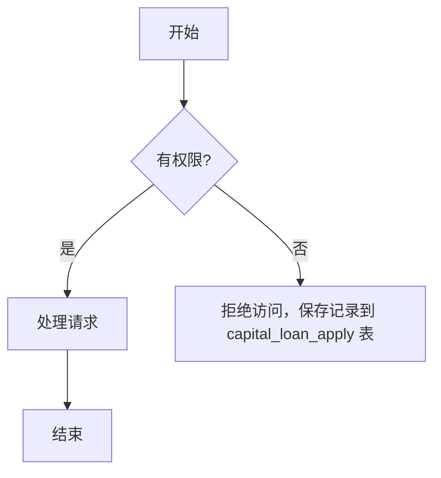

> 本页维护当前契约。本次差异、风险、测试结果与评审结论统一放在设计文档。按适用场景填写，未核实写待确认；不适用写依据。

# 对应批任务
> 该任务组件所属的批任务，用双链引入批任务文档。
{{：对应批任务链接，例如 [[8.xxljob/执行器/任务/批任务名称|批任务名称]]}}

# 任务说明
> 说明该任务做什么、何时触发、失败如何处理。
> 使用流程图或者时序图说明

{{：任务简述，描述任务做什么}}

# 涉及的业务范围
> 需要写明该批量涉及处理的业务范围。不接受“标准化所有产品”这类含糊描述。需要穷举罗列。
{{：业务范围说明}}

# 批任务防止重复调度机制
> 注意：光靠丢弃后续调度作为防重调度不可靠。若调度在不同的执行器上，会出现未按照预期丢弃后续调度的场景。需要在批任务业务逻辑中保有防止重复调度的机制。
{{：防重机制说明}}
# 是否涉及调用外部接口
> 需要罗列所涉及的全部外部接口。调用外部接口关键字段说明需要在client接口文档中说明。
{{：调用外部接口情况说明，需要罗列完整调用外部的接口}}

# 调用外部接口的防重机制
> 发送外部接口前更新交易记录状态（记录是否发送外部），并通过乐观锁避免重复调用
{{：说明如何防止重复调用外部接口}}

# 是否涉及交易状态判断
> 阐述该批量任务中是否涉及业务交易状态判断，及判断逻辑。阐述是否满足准则要求准则：“==明确成功才是成功，明确失败才是失败，其他处理中。==”
{{：具体说明交易状态判断逻辑，避免交易状态错误判断}}

# 涉及到分页必须有排序
> 是否涉及分页？若涉及分页必须有可靠的排序规则，否则可能出现不同页之间数据重复或遗漏。若分页未进行排序可能出现第 1 页和第 2 页其中部分数据重复的情况。
{{：说明分页的排序规则}}
