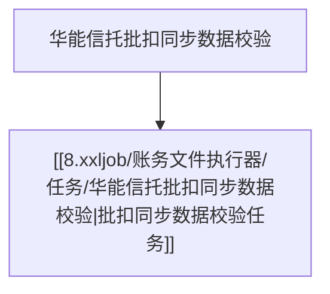

> 本页维护当前契约。本次差异、风险、测试结果与评审结论统一放在设计文档。按适用场景填写，未核实写待确认；不适用写依据。

# 对应任务流
> 该批任务所属的任务流，用双链引入任务流文档。
{{：对应任务流链接，例如 [[8.xxljob/执行器/任务流/任务流名称|任务流名称]]}}

# 任务说明
> 说明该任务做什么、何时触发、失败如何处理。
> 使用流程图或者时序图说明。任务流的流程图中可以直接引用对应的任务。

{{：任务简述，描述任务做什么}}

